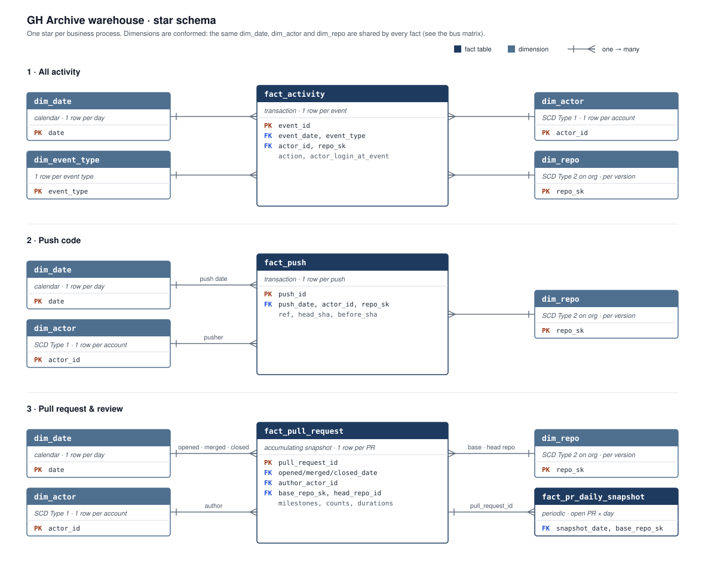

# GH Archive Warehouse — Dimensional Model Design

**Status:** design complete (Step 4) · implemented in dbt in Step 5
**Source:** `gharchive.silver_events`, one row per public GitHub event (built in Step 3)
**Method:** Kimball dimensional modeling, worked through in eight steps: users → business processes → questions → grain → dimensions → measures → slowly changing attributes → edge cases.

---

## 1. Goal

Turn a single wide event table (one row per event, with type-specific details in a JSON `payload`) into a star schema that answers questions about repositories, developers, and the pull-request workflow with simple SQL, and stays correct as the data grows from one day to a year.

## 2. Where this sits

```
bronze     raw hourly JSON on S3                      kept exactly as received
  ↓
silver     silver_events: one clean row per event     technical cleaning (types, UTC, dedupe)
  ↓
gold       fact_* and dim_* tables (this document)    business view: processes and entities
  ↓
reporting  aggregates and metric views               metric definitions for specific questions
```

**Layering rule:** silver does technical cleaning that is the same for everyone and rarely changes. Gold holds business classification and rules, which change as understanding improves; for example, the bot rule lives in `dim_actor`, so changing it rebuilds one small table instead of reprocessing all events in Spark. Reporting holds metric definitions, such as "median hours to merge, excluding bots, full lifecycles only."

## 3. Users and questions

| User | Focus | Example questions |
|---|---|---|
| Platform / product | Repositories | Which repos are most active (pushes, PRs)? Most popular (new stars, forks)? |
| Community / growth | Developers | Daily and weekly active developers? Top contributors, excluding bots? New contributors per repo? |
| Maintainers / operations | Workflow inside a repo | How long from PR opened to merged? How much review does a PR get? Release cadence? |
| Data engineering | The data itself | Do historical numbers stay correct when a repo moves to an organization? |

**Out of scope, because the data can't answer it:** private activity, revenue, page views, clones, code quality.

## 4. Business processes → fact tables

The 16 event types are grouped by **business process**, not one table per event type.

| Business process | Source events | Modeled as |
|---|---|---|
| Push code | PushEvent | `fact_push` |
| Pull request & review | PullRequestEvent, PullRequestReviewEvent, PullRequestReviewCommentEvent, IssueCommentEvent on PRs | `fact_pull_request` |
| Issue tracking | IssuesEvent, IssueCommentEvent on issues | future `fact_issue` (same pattern as PRs) |
| Stars & forks | WatchEvent, ForkEvent | `fact_activity` |
| Releases | ReleaseEvent | `fact_activity` |
| Branches, repo admin, other | CreateEvent, DeleteEvent, MemberEvent, PublicEvent, GollumEvent, CommitCommentEvent, DiscussionEvent | `fact_activity` |

### Bus matrix (which facts share which dimensions)

| Fact | dim_date | dim_actor | dim_repo | dim_event_type |
|---|---|---|---|---|
| `fact_activity` | ✓ | ✓ | ✓ | ✓ |
| `fact_push` | ✓ | ✓ | ✓ | |
| `fact_pull_request` | ✓ (opened, merged, closed) | ✓ (author) | ✓ (base and head) | |
| `fact_pr_daily_snapshot` | ✓ | | ✓ | |

These are **conformed dimensions**: every fact uses the same `dim_actor` and `dim_repo`, so "a developer" and "a repository" mean the same thing everywhere.

## 5. Star schema

One star per business process: each fact table sits in the middle, and its dimensions sit beside it. The dimensions are conformed: `dim_date`, `dim_actor`, and `dim_repo` are the same tables in every star, as the bus matrix above shows. Drawing all four facts in a single picture would force lines to cross.



Three kinds of fact table appear in one model:

| Type | One row is | Updated? | Table |
|---|---|---|---|
| Transaction | one event at one moment | no, append only | `fact_activity`, `fact_push` |
| Accumulating snapshot | one object's whole lifecycle, with fixed milestones | yes, as milestones happen | `fact_pull_request` |
| Periodic snapshot | the state of each open object at a regular interval | no, one new batch per period | `fact_pr_daily_snapshot` (optional) |

## 6. Table specifications

### `fact_activity`: one row per public event

Type: transaction, factless (the measure is `COUNT(*)`). Primary key: `event_id`.

| Column | Description |
|---|---|
| `event_id` | GitHub event id; a degenerate dimension |
| `event_ts` | When the event happened (UTC) |
| `event_date` | FK → `dim_date` |
| `event_type` | FK → `dim_event_type` |
| `actor_id` | FK → `dim_actor` |
| `repo_sk` | FK → `dim_repo`, the version valid at `event_ts` |
| `repo_id` | Natural repo key (for current-state joins) |
| `action` | `payload.action` when present (opened, merged, started, …) |
| `actor_login_at_event` | Login as it was when the event happened |
| `repo_name_at_event` | Repo name as it was when the event happened |

### `fact_push`: one row per push

Type: transaction, factless. Primary key: `push_id`.

| Column | Description |
|---|---|
| `push_id` | `payload.push_id` |
| `event_id` | Source event |
| `pushed_at`, `push_date` | Timestamp; FK → `dim_date` |
| `actor_id` | FK → `dim_actor` |
| `repo_sk`, `repo_id` | FK → `dim_repo`; natural key |
| `ref`, `branch_name` | e.g. `refs/heads/main` → `main` |
| `head_sha`, `before_sha` | Commit after and before the push |

The 2026 PushEvent payload contains only `head`, `before`, `push_id`, `ref`, and `repository_id`. There is no commit count or commit list, so this fact has no numeric measures.

### `fact_pull_request`: one row per pull request

Type: accumulating snapshot. Primary key: `pull_request_id`. Business key: (`base_repo_id`, `pr_number`).

The grain is **one PR, not one PR event**, so that "opened" and "merged" sit in the same row and durations are a subtraction rather than a self-join. A PR opened before the data window still gets a row, built from the events we do see.

| Column | Description |
|---|---|
| `pull_request_id` | Global PR id (`payload.pull_request.id`) |
| `pr_number` | Number within the repo (shared counter with issues) |
| `base_repo_sk`, `base_repo_id` | Target repo (role-playing `dim_repo`) |
| `head_repo_id` | Source repo; differs from base for PRs from forks |
| `is_from_fork` | `head_repo_id <> base_repo_id` |
| `base_ref`, `head_ref` | Target and source branch names |
| `author_actor_id` | Actor of the `opened` event; null if opened before the window |
| `opened_at`, `merged_at`, `closed_at` | Milestones from event `created_at` + `action` |
| `opened_date`, `merged_date`, `closed_date` | FKs → `dim_date` (role-playing) |
| `last_event_at` | Latest event seen for this PR |
| `final_state` | `open`, `merged`, or `closed_unmerged` as of the data end |
| `is_merged`, `is_closed_unmerged` | 0/1 flags |
| `hours_to_merge` | `merged_at - opened_at`; null unless both observed |
| `hours_to_close_unmerged` | `closed_at - opened_at` for PRs closed without merge |
| `is_full_lifecycle` | Opening and ending both observed inside the loaded window |
| `review_count` | PullRequestReviewEvent |
| `review_comment_count` | PullRequestReviewCommentEvent (line comments) |
| `conversation_comment_count` | IssueCommentEvent on the PR, joined by repo + number |
| `label_added_count`, `label_removed_count` | `labeled` / `unlabeled` actions |
| `assign_count`, `reopen_count` | `assigned` / `reopened` actions |
| `participant_count` | Distinct actors with any event on this PR |

Implementation: dbt incremental model, `unique_key = pull_request_id`. New PRs are inserted; existing PRs are updated when new events arrive.

The 2026 PR payload does not include title, author, state, or timestamps, so milestones and the author are derived from the events themselves.

### `fact_pr_daily_snapshot` (optional): one row per open PR per day

Type: periodic snapshot. Primary key: (`snapshot_date`, `pull_request_id`).

| Column | Description |
|---|---|
| `snapshot_date` | FK → `dim_date` |
| `pull_request_id` | FK → `fact_pull_request` |
| `base_repo_sk` | FK → `dim_repo` |
| `age_days` | Days open as of `snapshot_date`; null if opened before the window |

This supports aging trends ("how many PRs have been open more than 7 days, day by day"), which a single "current age" column can't show.

### `dim_actor`: one row per GitHub account

SCD Type 1. Primary key: `actor_id`.

| Column | Description |
|---|---|
| `actor_id` | GitHub user id |
| `login` | Latest known login |
| `is_bot` | Rule-based; v1: login ends in `[bot]` |
| `first_seen_date`, `last_seen_date` | Within the loaded data |

### `dim_repo`: one row per repository version

SCD Type 2 on organization ownership, Type 1 on everything else. Primary key: `repo_sk`.

| Column | Description |
|---|---|
| `repo_sk` | Surrogate key, one per version |
| `repo_id` | GitHub repo id (natural key) |
| `repo_name` | Latest non-empty `owner/name` |
| `owner_login`, `short_name` | Split from `repo_name` |
| `org_id`, `org_login` | Owning organization (null for personal repos; ~91% of events) |
| `valid_from`, `valid_to`, `is_current` | Type 2 validity range |

It includes an **unknown member** row (`repo_sk = -1`, `repo_name = 'Unknown'`), so fact foreign keys are never null and rows never drop out of joins. Implementation: dbt snapshot.

### `dim_date`

A standard calendar: date, day of week, weekend flag, week, month, quarter, year.

### `dim_event_type`

| Column | Description |
|---|---|
| `event_type` | e.g. `PullRequestEvent` |
| `business_process` | push, pull_request, issue, stars_forks, release, admin_other |

## 7. Measures and additivity

| Measure | Additivity | How to aggregate |
|---|---|---|
| `COUNT(*)` on transaction facts | additive | sum across anything |
| Review, comment, and label counts | additive | sum |
| `is_merged`, `is_closed_unmerged` | additive | sum = number of PRs |
| `hours_to_merge` | additive | `SUM / COUNT`, or median, at query time |
| `participant_count` | **non-additive** | never sum across PRs; distinct contributors per repo come from `fact_activity` |
| `age_days` in the daily snapshot | **semi-additive** | sum across PRs within one day; never across days |

**Rule:** store raw components (timestamps, per-row durations, counts), never averages, ratios, or "age as of today." Those are computed in reporting.

## 8. Slowly changing attributes

| Attribute | Type | Reasoning |
|---|---|---|
| Actor login | 1 | Renames are rare. The fact tables already keep `actor_login_at_event`, so history is available without a Type 2 dimension. |
| Repo organization ownership | **2** | Moving a repo into an org changes "activity by organization." Past activity should stay with the owner at the time. |
| Repo name, other repo attributes | 1 | Latest value is enough for display. |

## 9. Edge cases and data quality

| Case | Handling | Layer |
|---|---|---|
| Bots (e.g. dependabot) skew merge times and contributor rankings | Flag with `is_bot` and keep; reporting decides whether to exclude | `dim_actor` |
| PRs opened before or still open after the window (censoring) | Keep the row; durations null; `is_full_lifecycle` flag; time-to-merge metrics use cohorts with a fixed follow-up period (e.g. "% merged within 7 days by open month"), excluding immature cohorts | `fact_pull_request` + reporting |
| Non-public events (17 in the sample day) | Kept in silver; excluded in gold (out of scope) | gold staging |
| Empty `repo_name` on some ForkEvents | Name comes from the repo's other events; otherwise the unknown member | `dim_repo` |
| Duplicate event ids | Removed in silver (0 found in the sample day) | silver |

**Planned dbt tests:** `unique` and `not_null` on every primary key; `relationships` from fact FKs to dimensions; accepted values for `final_state`. Volume checks: non-public event count stays small; daily event count within an expected range.

## 10. Known limitations

- **Censoring is permanent.** Every window has edges. A warm-up period of earlier data fixes most left censoring, and right-censored PRs are reported as "still open," not dropped.
- **Account-level bot detection only.** A human account running automation (scripts, personal tokens in CI) can't be identified from this data.
- **The 2026 payloads are trimmed.** There are no PR titles, commit counts, or diff sizes.
- **Stars are gross, not net.** WatchEvent only records `started`; there is no unstar event.
- **Only public activity** is in GH Archive.

## 11. Alternatives considered

| Option | Decision | Why |
|---|---|---|
| One fact table per event type, plus a `dim_event` | Rejected | Events are facts, not dimensions; the model should follow business processes, not the source system's categories. |
| Only `fact_activity` | Rejected | It can't hold process-specific columns or express a PR's lifecycle across events. |
| PR grain = one PR event | Rejected | Durations would need self-joins, and PRs opened before the window would have no anchor row. |
| SCD Type 2 on `dim_actor` | Rejected | Costly for a rare change; the facts already store the login at event time. |
| Store "current age" on `fact_pull_request` | Rejected | It rewrites every open row daily and depends on the run date; age is computed at query time, and trends use the periodic snapshot. |
| `revision_push_count` (pushes to the PR branch while open) | Deferred | Feasible by joining `fact_push` on head repo, branch, and time window; outside the MVP. |

## 12. Future extensions

- `fact_issue` (accumulating snapshot, same pattern as PRs)
- `bridge_pr_label` for the many-to-many relationship between PRs and labels
- `revision_push_count` on `fact_pull_request`
- Both GH Archive eras (2011–2014 Timeline API vs 2015+ Events API) in Step 7
