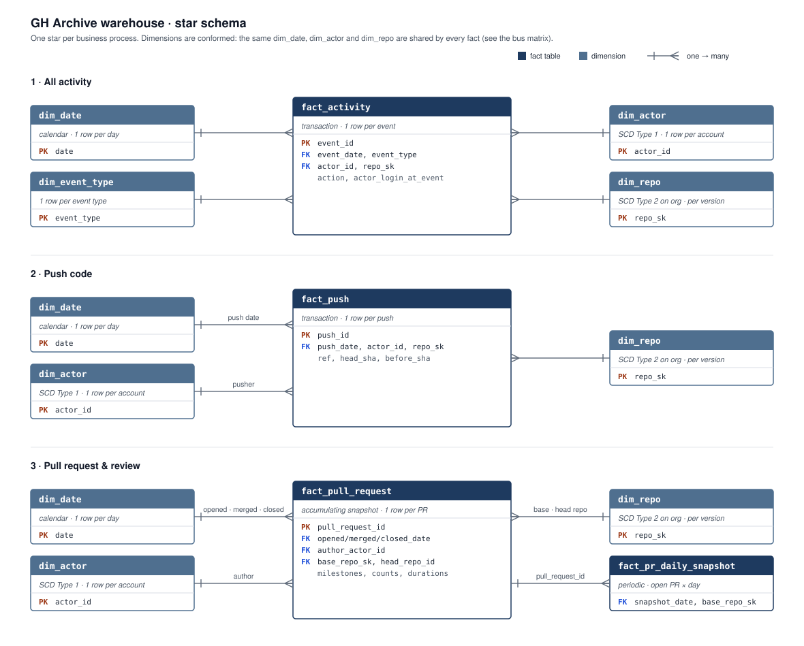

# GH Archive Warehouse — Dimensional Model Design

**Status:** design complete (Step 4) · implemented in dbt in Step 5
**Source:** `gharchive.silver_events`, one row per public GitHub event (built in Step 3)
**Method:** Kimball dimensional modeling, worked through in eight steps: users → business processes → questions → grain → dimensions → measures → slowly changing attributes → edge cases.

---

## 1. Goal

Turn a single wide event table (one row per event, with type-specific details in a JSON `payload`) into a star schema that answers questions about repositories, developers, and the pull-request workflow with simple SQL, and stays correct as the data grows from one day to a year.

## 2. Where this sits

```
bronze     raw hourly JSON on S3                      kept exactly as received
  ↓
silver     silver_events: one clean row per event     technical cleaning (types, UTC, dedupe)
  ↓
gold       fact_* and dim_* tables (this document)    business view: processes and entities
  ↓
reporting  aggregates and metric views               metric definitions for specific questions
```

**Layering rule:** silver does technical cleaning that is the same for everyone and rarely changes. Gold holds business classification and rules, which change as understanding improves; for example, the bot rule lives in `dim_actor`, so changing it rebuilds one small table instead of reprocessing all events in Spark. Reporting holds metric definitions, such as "median hours to merge, excluding bots, full lifecycles only."

## 3. Users and questions

| User | Focus | Example questions |
|---|---|---|
| Platform / product | Repositories | Which repos are most active (pushes, PRs)? Most popular (new stars, forks)? |
| Community / growth | Developers | Daily and weekly active developers? Top contributors, excluding bots? New contributors per repo? |
| Maintainers / operations | Workflow inside a repo | How long from PR opened to merged? How much review does a PR get? Release cadence? |
| Data engineering | The data itself | Do historical numbers stay correct when a repo moves to an organization? |

**Out of scope, because the data can't answer it:** private activity, revenue, page views, clones, code quality.

## 4. Business processes → fact tables

The 16 event types are grouped by **business process**, not one table per event type.

| Business process | Source events | Modeled as |
|---|---|---|
| Push code | PushEvent | `fact_push` |
| Pull request & review | PullRequestEvent, PullRequestReviewEvent, PullRequestReviewCommentEvent, IssueCommentEvent on PRs | `fact_pull_request` |
| Issue tracking | IssuesEvent, IssueCommentEvent on issues | future `fact_issue` (same pattern as PRs) |
| Stars & forks | WatchEvent, ForkEvent | `fact_activity` |
| Releases | ReleaseEvent | `fact_activity` |
| Branches, repo admin, other | CreateEvent, DeleteEvent, MemberEvent, PublicEvent, GollumEvent, CommitCommentEvent, DiscussionEvent | `fact_activity` |

### Bus matrix (which facts share which dimensions)

| Fact | dim_date | dim_actor | dim_repo | dim_event_type |
|---|---|---|---|---|
| `fact_activity` | ✓ | ✓ | ✓ | ✓ |
| `fact_push` | ✓ | ✓ | ✓ | |
| `fact_pull_request` | ✓ (opened, merged, closed) | ✓ (author) | ✓ (base and head) | |
| `fact_pr_daily_snapshot` | ✓ | | ✓ | |

These are **conformed dimensions**: every fact uses the same `dim_actor` and `dim_repo`, so "a developer" and "a repository" mean the same thing everywhere.

## 5. Star schema

One star per business process: each fact table sits in the middle, and its dimensions sit beside it. The dimensions are conformed: `dim_date`, `dim_actor`, and `dim_repo` are the same tables in every star, as the bus matrix above shows. Drawing all four facts in a single picture would force lines to cross.



Three kinds of fact table appear in one model:

| Type | One row is | Updated? | Table |
|---|---|---|---|
| Transaction | one event at one moment | no, append only | `fact_activity`, `fact_push` |
| Accumulating snapshot | one object's whole lifecycle, with fixed milestones | yes, as milestones happen | `fact_pull_request` |
| Periodic snapshot | the state of each open object at a regular interval | no, one new batch per period | `fact_pr_daily_snapshot` (optional) |

## 6. Table specifications

### `fact_activity`: one row per public event

Type: transaction, factless (the measure is `COUNT(*)`). Primary key: `event_id`.

| Column | Description |
|---|---|
| `event_id` | GitHub event id; a degenerate dimension |
| `event_ts` | When the event happened (UTC) |
| `event_date` | FK → `dim_date` |
| `event_type` | FK → `dim_event_type` |
| `actor_id` | FK → `dim_actor` |
| `repo_sk` | FK → `dim_repo`, the version valid at `event_ts` |
| `repo_id` | Natural repo key (for current-state joins) |
| `action` | `payload.action` when present (opened, merged, started, …) |
| `actor_login_at_event` | Login as it was when the event happened |
| `repo_name_at_event` | Repo name as it was when the event happened |

### `fact_push`: one row per push

Type: transaction, factless. Primary key: `push_id`.

| Column | Description |
|---|---|
| `push_id` | `payload.push_id` |
| `event_id` | Source event |
| `pushed_at`, `push_date` | Timestamp; FK → `dim_date` |
| `actor_id` | FK → `dim_actor` |
| `repo_sk`, `repo_id` | FK → `dim_repo`; natural key |
| `ref`, `branch_name` | e.g. `refs/heads/main` → `main` |
| `head_sha`, `before_sha` | Commit after and before the push |

The 2026 PushEvent payload contains only `head`, `before`, `push_id`, `ref`, and `repository_id`. There is no commit count or commit list, so this fact has no numeric measures.

### `fact_pull_request`: one row per pull request

Type: accumulating snapshot. Primary key: the business key (`base_repo_id`, `pr_number`), plus a surrogate `pr_sk` (a hash of the two) for joins.

Why not `pull_request_id`: PR conversation comments arrive as IssueCommentEvents, which carry only the repo and `issue.number`, not the PR id. Every PR-related event carries repo + number, so keying on it lets every event attach to its PR directly, with no lookup. This includes PRs whose only event inside the window is a comment. Repo + number maps one-to-one to `pull_request_id` (checked on the sample day: 0 conflicts; enforced as a dbt test).

The grain is **one PR, not one PR event**, so that "opened" and "merged" sit in the same row and durations are a subtraction rather than a self-join. A PR opened before the data window still gets a row, built from the events we do see.

| Column | Description |
|---|---|
| `pr_sk` | Surrogate key: hash of (`base_repo_id`, `pr_number`) |
| `base_repo_id`, `pr_number` | Business key: target repo + number within the repo (shared counter with issues) |
| `base_repo_sk` | FK → `dim_repo` (role-playing) |
| `pull_request_id` | Global PR id (`payload.pull_request.id`); null if only comment events were seen |
| `head_repo_id` | Source repo; differs from base for PRs from forks |
| `is_from_fork` | `head_repo_id <> base_repo_id` |
| `base_ref`, `head_ref` | Target and source branch names, **latest non-null value seen** (the target branch can change during a PR's life, e.g. a stacked PR retargeted to `main`) |
| `author_actor_id` | Actor of the `opened` event; otherwise the PR author from a comment snapshot; else null |
| `opened_at`, `merged_at`, `closed_at` | Milestones from event `created_at` + `action`; when the event wasn't seen, from the PR snapshot carried by conversation comments (`issue.created_at`, `issue.pull_request.merged_at`, `issue.closed_at`) |
| `opened_at_source` | `event`, `snapshot`, or null: where `opened_at` came from (data provenance) |
| `opened_date`, `merged_date`, `closed_date` | FKs → `dim_date` (role-playing) |
| `first_event_at`, `last_event_at` | Earliest and latest event seen for this PR (`last_event_at` drives the incremental lookback) |
| `final_state` | `open`, `merged`, or `closed_unmerged` as of the data end; count PRs by state with `count_if(final_state = 'merged')` (no separate 0/1 flag columns) |
| `hours_to_merge` | `merged_at - opened_at`; null unless both observed |
| `hours_to_close_unmerged` | `closed_at - opened_at` for PRs closed without merge |
| `is_full_lifecycle` | Opening and ending both observed inside the loaded window |
| `review_count` | PullRequestReviewEvent |
| `review_comment_count` | PullRequestReviewCommentEvent (line comments) |
| `conversation_comment_count` | IssueCommentEvent on the PR, joined by repo + number |
| `label_added_count`, `label_removed_count` | `labeled` / `unlabeled` actions |
| `assign_count`, `reopen_count` | `assigned` / `reopened` actions |
| `participant_count` | Distinct actors with any event on this PR |

Implementation: `int_pr_events` (one row per PR-related event, 4 event types unified) and `int_pr_snapshots` (one row per PR, from comment snapshots) feed a dbt incremental model on an Iceberg table, `incremental_strategy = merge`, `unique_key = pr_sk`, not partitioned (a PR's dates change as events arrive). Each run finds the PRs touched in the last 2 days and recomputes those rows from all of their events, then merges them in. `pr_sk` comes from one dbt macro so every model computes it identically.

**PR snapshot in comments.** In 2026, PullRequestEvent payloads are trimmed, but IssueCommentEvent payloads carry the full underlying issue record of the PR: creation time, author, state, closed/merged time, title, labels. Verified on the sample day: for all 59 PRs with both an `opened` event and a comment, the snapshot's author and creation time match the event (62/62 event pairs).

The 2026 PR payload does not include title, author, state, or timestamps, so milestones and the author are derived from the events themselves.

### `fact_pr_daily_snapshot` (optional): one row per open PR per day

Type: periodic snapshot. Primary key: (`snapshot_date`, `pr_sk`).

| Column | Description |
|---|---|
| `snapshot_date` | FK → `dim_date` |
| `pr_sk` | FK → `fact_pull_request` |
| `base_repo_sk` | FK → `dim_repo` |
| `age_days` | Days open as of `snapshot_date`; null if opened before the window |

This supports aging trends ("how many PRs have been open more than 7 days, day by day"), which a single "current age" column can't show.

### `dim_actor`: one row per GitHub account

SCD Type 1. Primary key: `actor_id`. Covers every account **mentioned** in the data: accounts that performed an event, plus PR authors known only from comment snapshots (they performed no event in the window), so every `fact_pull_request.author_actor_id` has a match. Without them, 424 PRs on the sample day (405 authors, 13 of the PRs by bots) would drop out of any "exclude bots" join. Snapshot-only authors are added with an anti-join (`not exists`), so each account appears once and the event login wins.

| Column | Description |
|---|---|
| `actor_id` | GitHub user id |
| `login` | Latest known login |
| `is_bot` | Rule-based; v1: login ends in `[bot]` (false if login is missing) |
| `first_seen_date`, `last_seen_date` | First / last event within the loaded data; null for snapshot-only accounts |
| `source` | `event` or `snapshot_only` (how the account entered the dimension) |

### `dim_repo`: one row per repository version

SCD Type 2 on organization ownership, Type 1 on everything else. Primary key: `repo_sk`.

| Column | Description |
|---|---|
| `repo_sk` | Surrogate key, one per version |
| `repo_id` | GitHub repo id (natural key) |
| `repo_name` | Latest non-empty `owner/name` |
| `owner_login`, `short_name` | Split from `repo_name` |
| `org_id`, `org_login` | Owning organization (null for personal repos; ~91% of events) |
| `valid_from`, `valid_to`, `is_current` | Type 2 validity range |

It includes an **unknown member** row (`repo_sk = '-1'`, `repo_name = 'Unknown'`), so fact foreign keys are never null and rows never drop out of joins.

Implementation: built from event history by **event time**, not dbt snapshot (snapshot stamps processing time and would break on backfills). Gaps and islands: flag `org_id` changes with `lag()` and `is distinct from`, running-sum the flags into a version number, group by version. Intervals are half-open `[valid_from, valid_to)`; the first version starts at 1900-01-01 (so PRs whose `opened_at` comes from a pre-window comment snapshot still find a version) and the current one ends at 9999-12-31. `repo_sk` = md5(`repo_id`, `valid_from`) via the project's `surrogate_key` macro. The exact transfer moment is unknown; a new version starts at its first event.

Sample-day profile: 801,936 repos; 93 changed ownership, each exactly once (no flip-flopping, so a null org means "personal", not missing data). 88 of them look like a personal account converted into an organization (repo owner = new org), 5 went from an org to personal, 0 moved to a different org.

Facts link to it with a point-in-time join (`event_ts >= valid_from and event_ts < valid_to`) and `coalesce(repo_sk, '-1')`: `fact_activity` / `fact_push` at the event time, `fact_pull_request.base_repo_sk` at the PR's opening (`opened_at`, else `first_event_at`). The 2-day incremental lookback re-links recent events if `dim_repo` gains a new version after they were loaded.

### `dim_date`

A standard calendar, one row per day from 2011-01-01 to 2026-12-31, generated in SQL. Primary key `date_day` (not `date`, which is a SQL reserved word); also day of week, weekend flag, week start, month, quarter, year.

### `dim_event_type`

| Column | Description |
|---|---|
| `event_type` | e.g. `PullRequestEvent` |
| `business_process` | push, pull_request, issue, stars_forks, release, admin_other |

## 7. Measures and additivity

| Measure | Additivity | How to aggregate |
|---|---|---|
| `COUNT(*)` on transaction facts | additive | sum across anything |
| Review, comment, and label counts | additive | sum |
| PRs by `final_state` | additive | `count_if(final_state = …)` = number of PRs |
| `hours_to_merge` | additive | `SUM / COUNT`, or median, at query time |
| `participant_count` | **non-additive** | never sum across PRs; distinct contributors per repo come from `fact_activity` |
| `age_days` in the daily snapshot | **semi-additive** | sum across PRs within one day; never across days |

**Rule:** store raw components (timestamps, per-row durations, counts), never averages, ratios, or "age as of today." Those are computed in reporting.

## 8. Slowly changing attributes

| Attribute | Type | Reasoning |
|---|---|---|
| Actor login | 1 | Renames are rare. The fact tables already keep `actor_login_at_event`, so history is available without a Type 2 dimension. |
| Repo organization ownership | **2** | Moving a repo into an org changes "activity by organization." Past activity should stay with the owner at the time. |
| Repo name, other repo attributes | 1 | Latest value is enough for display. |

## 9. Edge cases and data quality

| Case | Handling | Layer |
|---|---|---|
| Bots (e.g. dependabot) skew merge times and contributor rankings | Flag with `is_bot` and keep; reporting decides whether to exclude | `dim_actor` |
| PRs opened before or still open after the window (censoring) | Keep the row; durations null; `is_full_lifecycle` flag; time-to-merge metrics use cohorts with a fixed follow-up period (e.g. "% merged within 7 days by open month"), excluding immature cohorts | `fact_pull_request` + reporting |
| Non-public events (17 in the sample day) | Kept in silver; excluded in gold (out of scope) | gold staging |
| Empty `repo_name` on some ForkEvents; one ForkEvent with a null `repo_id` (sample day) | Name comes from the repo's other events; a null `repo_id` links to the unknown member (`repo_sk = '-1'`) | `dim_repo`, fact tables |
| Duplicate event ids | Removed in silver (0 found in the sample day) | silver |
| PRs opened before the window (75% of PRs seen on the sample day had no `opened` event) | Fill `opened_at` and author from comment snapshots where available (6,267 PRs); `opened_at_source` records which | `int_pr_snapshots`, `fact_pull_request` |
| PR authors known only from a comment snapshot have no event in the window (424 PRs / 405 authors on the sample day), so they were missing from `dim_actor`; caught by the `relationships` test | Added to `dim_actor` with `source = snapshot_only` and null seen-dates | `dim_actor` |
| Semantic duplicate pushes: the same push (same `push_id`, ref, head, before, actor, repo, timestamp) recorded as two PushEvents with different `event_id`s (170 of 2,481,416 pushes on the sample day; likely at-least-once delivery upstream) | Keep one row per `push_id` (smallest `event_id`, so reruns pick the same row); found by an idempotency rerun that failed the `fact_push` merge | gold staging (`stg_events`) |

**dbt tests (implemented in Step 5.7, 67 in total):** `unique` and `not_null` on every primary key (including `fact_push.push_id`); `relationships` from fact FKs to dimensions (`event_type`, `actor_id`, `author_actor_id`, `repo_sk`, `base_repo_sk`, and every date → `dim_date`); `accepted_values` for `final_state`, `opened_at_source`, `event_category`, `business_process`, `dim_actor.source`. Three singular tests: (base repo, number) ↔ `pull_request_id` is one-to-one in both directions; every event with a known `repo_id` falls into exactly one `dim_repo` version (no gaps, no overlaps); the comment snapshot agrees with the `opened` event on author and creation time (severity `warn`: it tests an assumption about the source). Still planned for Step 8: volume checks (non-public event count stays small; daily event count within an expected range).

## 10. Known limitations

- **The source feed misses events.** Of the 6,267 PRs whose `opened_at` came from a comment snapshot, 4,941 were created on the sample day itself, yet no `opened` event exists for them: at least 40% of PRs created that day have no `opened` event in GH Archive (cause unconfirmed: a lossy public events feed, or PRs created in ways that don't emit public events). Counting `opened` events undercounts new PRs; count by `opened_at` instead, and treat it as a lower bound. Planned: a completeness check in Step 8.
- **Censoring is permanent.** Every window has edges. A warm-up period of earlier data fixes most left censoring, and right-censored PRs are reported as "still open," not dropped.
- **Account-level bot detection only.** A human account running automation (scripts, personal tokens in CI) can't be identified from this data.
- **The 2026 payloads are trimmed.** There are no PR titles, commit counts, or diff sizes.
- **Stars are gross, not net.** WatchEvent only records `started`; there is no unstar event.
- **Only public activity** is in GH Archive.

## 11. Alternatives considered

| Option | Decision | Why |
|---|---|---|
| One fact table per event type, plus a `dim_event` | Rejected | Events are facts, not dimensions; the model should follow business processes, not the source system's categories. |
| Only `fact_activity` | Rejected | It can't hold process-specific columns or express a PR's lifecycle across events. |
| PR primary key = `pull_request_id` | Rejected | IssueCommentEvents don't carry it; comments on PRs with no other event in the window would be dropped. Repo + number is present on every PR-related event. |
| Comment-only columns on `int_pr_events` | Rejected | Most rows would be null and the table harder to read; the snapshot logic lives in its own model, `int_pr_snapshots`. |
| PR grain = one PR event | Rejected | Durations would need self-joins, and PRs opened before the window would have no anchor row. |
| SCD Type 2 on `dim_actor` | Rejected | Costly for a rare change; the facts already store the login at event time. |
| Store "current age" on `fact_pull_request` | Rejected | It rewrites every open row daily and depends on the run date; age is computed at query time, and trends use the periodic snapshot. |
| `revision_push_count` (pushes to the PR branch while open) | Deferred | Feasible by joining `fact_push` on head repo, branch, and time window; outside the MVP. |

## 12. Future extensions

- `fact_issue` (accumulating snapshot, same pattern as PRs)
- `bridge_pr_label` for the many-to-many relationship between PRs and labels
- `revision_push_count` on `fact_pull_request`
- Review outcomes (`approved_count`, `changes_requested_count`) from `review.state`
- Better bot detection from `user.type`, and automation detection from `performed_via_github_app` (both in comment payloads)
- Both GH Archive eras (2011–2014 Timeline API vs 2015+ Events API) in Step 7
